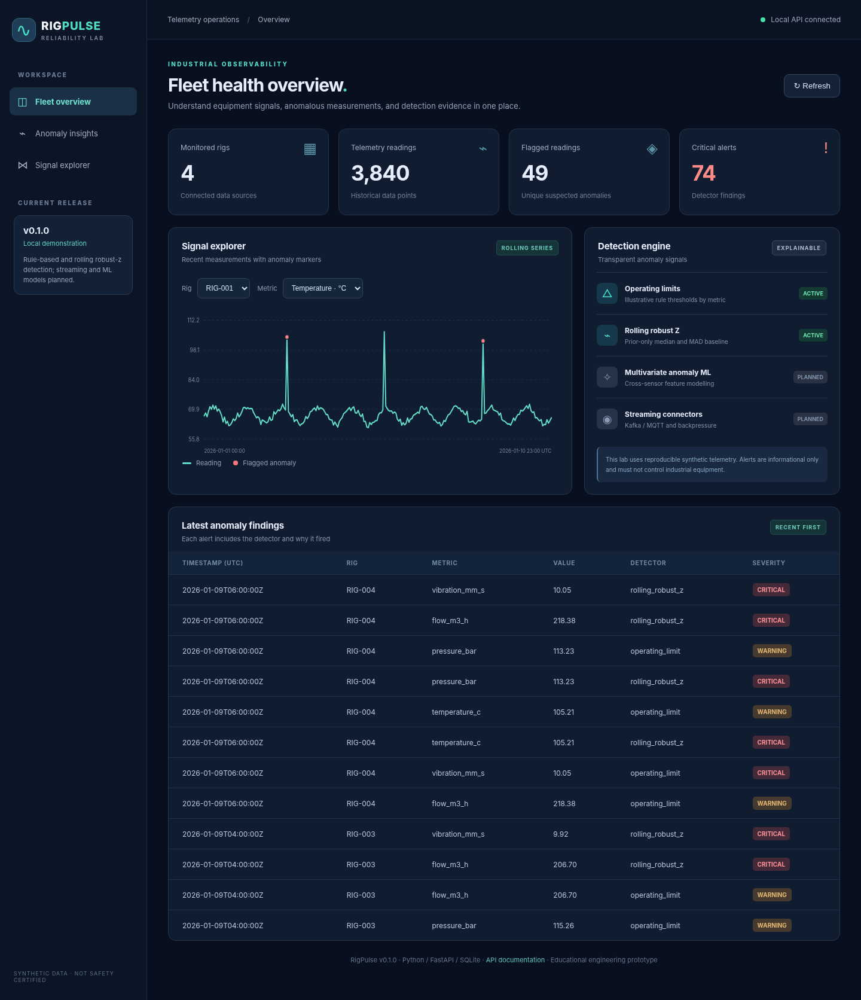

# RigPulse — Industrial Telemetry Reliability Lab

**A real, extensible Python software engineering project for observing, testing, and improving industrial time-series reliability.**

[](https://github.com/jnbalaji-jb/rigpulse-telemetry-lab/actions/workflows/tests.yml)


> **Project status: `v0.2.0` (Milestones M1 & M2 complete; Milestone M3 in progress).** A runnable telemetry reliability lab with univariate baselines, causal multivariate Isolation Forest anomaly detection (M1), event-time streaming ingestion with watermarks and checkpoints (M2), and alert correlation/incident lifecycle management (M3). Uses synthetic data and illustrative operating limits only. It is **not an industrial safety or control system**. Production-grade authentication, RBAC, and multi-tenant deployment (M4) remain planned future work.



## The problem

Oilfield and other industrial equipment emits temperature, pressure, vibration, and flow readings. Anomalies can be subtle, context-dependent, and difficult to troubleshoot. This project explores a modular monitoring platform with **interpretable detectors, leak-free multivariate ML, reproducible experiments, resilient streaming ingestion, and structured incident workflows**.

Unlike a single notebook, RigPulse is an installable Python package with a CLI, REST API, SQLite persistence, a browser UI, automated tests, CI, and a maintained engineering backlog.

## What works today

| Capability | Status | Implementation |
| --- | --- | --- |
| Reproducible time-series simulation | ✅ Implemented | Seeded generator, separate synthetic event labels |
| Data-quality validation | ✅ Implemented | ISO 8601 UTC conversion, finite values, sensor schema |
| Idempotent CSV ingestion | ✅ Implemented | SQLite uniqueness constraints and transactions |
| Explainable operating-limit alerts | ✅ Implemented | Configured example limits per metric |
| Statistical anomaly detection | ✅ Implemented | Rolling median + MAD, past observations only |
| Time-aligned causal features | ✅ Implemented | `rigpulse features` / `docs/FEATURE_ENGINEERING.md` |
| Multivariate anomaly ML (M1) | ✅ Implemented | Leak-free Isolation Forest, temporal & LORO backtesting (`rigpulse train` / `rigpulse compare`) |
| Distribution drift report | ✅ Implemented | Quantile-bin PSI early vs late comparison |
| Offline quantitative evaluation | ✅ Implemented | Precision, recall, F1, PR-AUC, false alerts/rig-day on synthetic events |
| Interactive telemetry dashboard | ✅ Implemented | Responsive vanilla JS + inline SVG |
| REST API and documentation | ✅ Implemented | FastAPI and `/docs` |
| Automated tests and GitHub CI | ✅ Implemented | pytest / Python 3.11 and 3.12 |
| Event-time streaming & checkpoints (M2) | ✅ Implemented | Typed `StreamEnvelope`, mock MQTT/Kafka connectors, `BoundedEventQueue`, watermarks, SQLite checkpoints (`src/rigpulse/streaming.py`) |
| Alert correlation & incident workflows (M3) | ✅ Implemented | Per-rig alert grouping, lifecycle states (`open`, `acknowledged`, `investigating`, `resolved`), analyst notes, API & CLI (`src/rigpulse/incidents.py`) |
| RBAC, Postgres, telemetry / deployment | 🟡 Planned | Milestone M4 |

## Quick start (Windows PowerShell, macOS or Linux)

Prerequisites: **Python 3.11+**, Git. No cloud account or paid API needed.

```bash
git clone [https://github.com/jnbalaji-jb/rigpulse-telemetry-lab.git](https://github.com/jnbalaji-jb/rigpulse-telemetry-lab.git)
cd rigpulse-telemetry-lab
python -m venv .venv