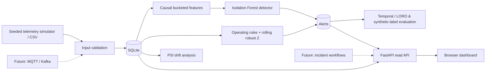

# RigPulse — Industrial Telemetry Reliability Lab

**A real, extensible Python software engineering project for observing, testing, and improving industrial time-series reliability.**

[](https://github.com/jnbalaji-jb/rigpulse-telemetry-lab/actions/workflows/tests.yml)


> **Project status: v0.2.0 (Milestone M1 complete).** A runnable foundation with univariate baselines and multivariate Isolation Forest anomaly detection, not a deployed production platform. Uses synthetic data and illustrative operating limits only. It is **not an industrial safety or control system**. Streaming ingestion, incident response, and production-grade security are planned future work.


## The problem

Oilfield and other industrial equipment emits temperature, pressure, vibration, and flow readings. Anomalies can be subtle, context-dependent, and difficult to troubleshoot. This project explores a modular monitoring platform with **interpretable detectors, leak-free multivariate ML, reproducible experiments, durable ingestion, and a clear extension path toward streaming monitoring**.

Unlike a single notebook, RigPulse is an installable Python package with a CLI, REST API, SQLite persistence, a browser UI, automated tests, CI, and a deliberately maintained engineering backlog.

## What works today

| Capability | Status | Implementation |
| --- | --- | --- |
| Reproducible time-series simulation | ✅ Implemented | Seeded generator, separate synthetic event labels |
| Data-quality validation | ✅ Implemented | ISO 8601 UTC conversion, finite values, sensor schema |
| Idempotent CSV ingestion | ✅ Implemented | SQLite uniqueness constraints and transactions |
| Explainable operating-limit alerts | ✅ Implemented | Configured example limits per metric |
| Statistical anomaly detection | ✅ Implemented | Rolling median + MAD, past observations only |
| Time-aligned causal features | ✅ Implemented | `rigpulse features` / `docs/FEATURE_ENGINEERING.md` |
| Multivariate anomaly ML (M1) | ✅ Implemented | Leak-free Isolation Forest, temporal & LORO backtesting (`rigpulse train` / `rigpulse compare`) |
| Distribution drift report | ✅ Implemented | Quantile-bin PSI early vs late comparison |
| Offline quantitative evaluation | ✅ Implemented | Precision, recall, F1, PR-AUC, false alerts/rig-day on synthetic events |
| Interactive telemetry dashboard | ✅ Implemented | Responsive vanilla JS + inline SVG |
| REST API and documentation | ✅ Implemented | FastAPI and `/docs` |
| Automated tests and GitHub CI | ✅ Implemented | pytest / Python 3.11 and 3.12 |
| MQTT / Kafka ingestion | 🟡 Planned | Milestone M2 |
| Incident management & explanations | 🟡 Planned | Milestone M3 |
| RBAC, Postgres, telemetry / deployment | 🟡 Planned | Milestone M4 |

## Quick start (Windows PowerShell, macOS or Linux)

Prerequisites: **Python 3.11+**, Git. No cloud account or paid API needed.

```bash
git clone https://github.com/jnbalaji-jb/rigpulse-telemetry-lab.git
cd rigpulse-telemetry-lab
python -m venv .venv
```

Activate the environment:

```powershell
# Windows PowerShell
.venv\Scripts\Activate.ps1
```

```bash
# macOS / Linux
source .venv/bin/activate
```

Install and run a complete local demo (generates data, ingests, trains Isolation Forest, scores univariate + ML detectors, runs temporal/LORO comparison):

```bash
python -m pip install -e ".[dev]"
rigpulse demo --db rigpulse.db --out demo_data --rigs 4 --hours 240 --seed 42
rigpulse serve --db rigpulse.db
```

Open **http://127.0.0.1:8000** for the monitoring dashboard or **http://127.0.0.1:8000/docs** for the interactive API documentation. Stop with Ctrl+C.

### Manual workflow

```bash
rigpulse generate --out demo_data --rigs 4 --hours 240 --seed 42
rigpulse ingest demo_data/telemetry.csv --db rigpulse.db
rigpulse features --db rigpulse.db --out reports/features.csv --bucket-minutes 60 --window 12
rigpulse train --db rigpulse.db --out models/isolation_forest.json --train-fraction 0.6
rigpulse detect --db rigpulse.db --window 48 --min-history 16 --z-threshold 4.5 --model models/isolation_forest.json
rigpulse summary --db rigpulse.db --out reports/summary.json
rigpulse drift --db rigpulse.db --out reports/drift.json
rigpulse evaluate --db rigpulse.db --truth demo_data/synthetic_ground_truth.csv --out reports/evaluation.json
rigpulse compare --db rigpulse.db --truth demo_data/synthetic_ground_truth.csv --out reports/m1_comparison.json
```

The generator outputs `telemetry.csv` and a **separate** `synthetic_ground_truth.csv`. **Ingestion, feature engineering, model training, and anomaly detection never use the ground-truth label.** It is used only by the `evaluate` and `compare` commands.

### Ingestion CSV schema

```csv
observed_at,rig_id,metric,value
2026-01-01T00:00:00Z,RIG-001,temperature_c,69.2
2026-01-01T01:00:00Z,RIG-001,pressure_bar,182.4
```

Metrics currently supported: `temperature_c`, `pressure_bar`, `vibration_mm_s`, `flow_m3_h`. Timestamps require a timezone, and are normalized to UTC. Exact duplicates (rig, metric, timestamp) are skipped.

## Explore the REST API

| Endpoint | Description |
| --- | --- |
| `GET /health` | Process health |
| `GET /api/v1/summary` | Counts and alert totals |
| `GET /api/v1/rigs` | Available rigs and metrics |
| `GET /api/v1/series?rig_id=RIG-001&metric=temperature_c` | Telemetry and alert markers |
| `GET /api/v1/alerts?limit=25` | Recent explainable alerts (rules, robust Z, and Isolation Forest) |
| `GET /docs` | Interactive OpenAPI documentation |

## Architecture



`src/rigpulse/` owns application code; `tests/` covers the data pipeline, ML isolation, and HTTP contract; `docs/` records design decisions and the next development work. See [Architecture](docs/ARCHITECTURE.md).

## Tests

```bash
python -m pytest -q
```

CI runs on Python 3.11 and 3.12. Tests check deterministic generation, input validation, idempotent re-ingestion and detection, causal feature alignment, Isolation Forest training/inference, temporal embargo splits, leave-one-rig-out backtesting, drift calculations, API validation, and the CLI demo.

## What I am building next

With **Milestone M1 (Multivariate Anomaly Learning)** completed, the next active milestone is **[M2: Real-Time Ingest and Resilience](docs/ROADMAP.md#milestone-m2--real-time-ingest-and-resilience)**: asynchronous MQTT/Kafka ingestion, event-time windows with out-of-order handling, and incremental detector state checkpoints.

Other upcoming work: incident grouping and human feedback (M3), granular access control, PostgreSQL support, and OpenTelemetry instrumentation (M4). See [Roadmap](docs/ROADMAP.md), [Engineering Backlog](docs/BACKLOG.md), and [Project Proposal](docs/PROJECT_PROPOSAL.md).

## Engineering principles and limitations

- **Correctness:** detectors and feature transformers only score against historical observations, avoiding future-data leakage; scalers and imputers fit strictly on training slices.
- **Reproducibility:** synthetic scenarios and Isolation Forest training use explicit seeds, and evaluation uses stored labels.
- **Traceability:** every finding stores a source measurement ID, detector, severity, score, and explanation.
- **Boundaries:** the current API is **local development only**, without authentication. Do not expose it on the public internet.
- **Safety:** example thresholds and ML scores are not equipment-specific safety limits; synthetic results do not validate deployment on physical rigs.

## License

MIT. Developed as an open, extensible learning and engineering project. Contributions and improvements are welcome; see [CONTRIBUTING.md](CONTRIBUTING.md).
