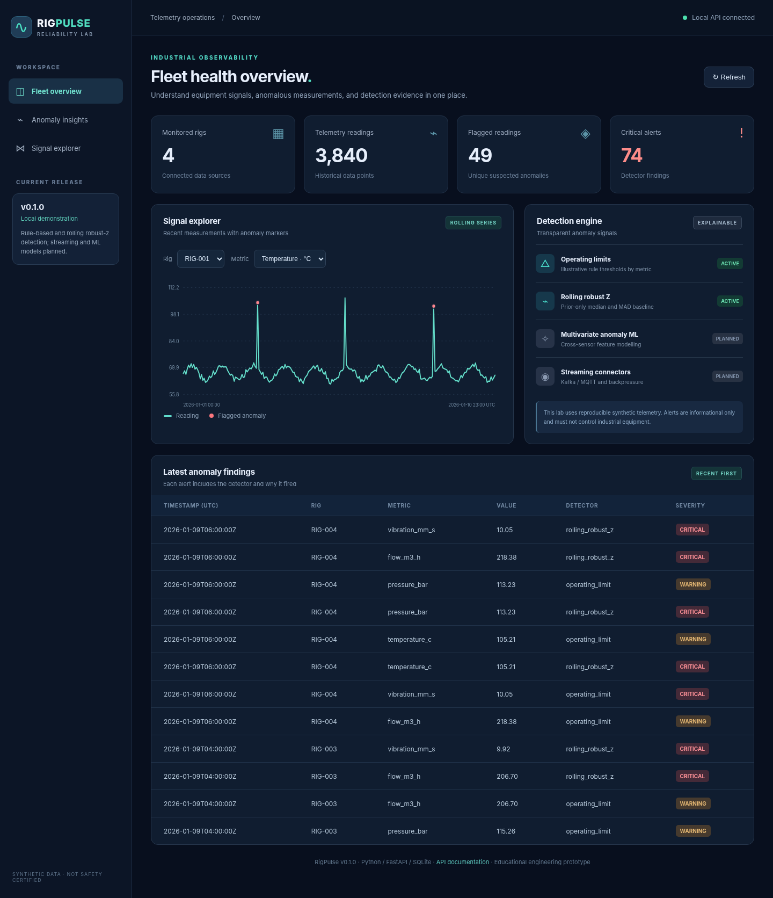
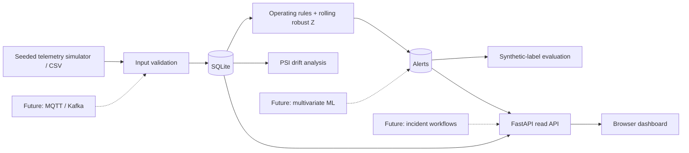

# RigPulse — Industrial Telemetry Reliability Lab

**A real, extensible Python software engineering project for observing, testing, and improving industrial time-series reliability.**

[](https://github.com/jnbalaji-jb/rigpulse-telemetry-lab/actions/workflows/tests.yml)


> **Project status: v0.1.0 prototype.** A runnable foundation, not a deployed production platform. Uses synthetic data and illustrative operating limits only. It is **not an industrial safety or control system**. Streaming ingestion, multivariate ML, incident response, and production-grade security are planned future work.



## The problem

Oilfield and other industrial equipment emits temperature, pressure, vibration, and flow readings. Anomalies can be subtle, context-dependent, and difficult to troubleshoot. This project explores a modular monitoring platform with **interpretable detectors, reproducible experiments, durable ingestion, and a clear extension path toward streaming ML-based monitoring**.

Unlike a single notebook, RigPulse is an installable Python package with a CLI, REST API, SQLite persistence, a browser UI, automated tests, CI, and a deliberately maintained engineering backlog.

## What works today

| Capability | Status | Implementation |
| --- | --- | --- |
| Reproducible time-series simulation | ✅ Implemented | Seeded generator, separate synthetic event labels |
| Data-quality validation | ✅ Implemented | ISO 8601 UTC conversion, finite values, sensor schema |
| Idempotent CSV ingestion | ✅ Implemented | SQLite uniqueness constraints and transactions |
| Explainable operating-limit alerts | ✅ Implemented | Configured example limits per metric |
| Statistical anomaly detection | ✅ Implemented | Rolling median + MAD, past observations only |
| Distribution drift report | ✅ Implemented | Quantile-bin PSI early vs late comparison |
| Offline quantitative evaluation | ✅ Implemented | Precision, recall, F1 on synthetic injected events |
| Interactive telemetry dashboard | ✅ Implemented | Responsive vanilla JS + inline SVG |
| REST API and documentation | ✅ Implemented | FastAPI and `/docs` |
| Automated tests and GitHub CI | ✅ Implemented | pytest / Python 3.11 and 3.12 |
| MQTT / Kafka ingestion | 🟡 Planned | Milestone M2 |
| Multivariate anomaly ML | 🟡 Planned | Milestone M1 |
| Incident management & explanations | 🟡 Planned | Milestone M3 |
| RBAC, Postgres, telemetry / deployment | 🟡 Planned | Milestone M4 |

## Quick start (Windows PowerShell, macOS or Linux)

Prerequisites: **Python 3.11+**, Git. No cloud account or paid API needed.

**If the repository is not published yet:** download the project ZIP, extract it, open a terminal inside the extracted folder, and skip the `git clone` and `cd` commands below.

```bash
git clone https://github.com/jnbalaji-jb/rigpulse-telemetry-lab.git
cd rigpulse-telemetry-lab
python -m venv .venv
```

Activate the environment:

```powershell
# Windows PowerShell
.venv\Scripts\Activate.ps1
```

```bash
# macOS / Linux
source .venv/bin/activate
```

Install and run a complete local demo:

```bash
python -m pip install -e ".[dev]"
rigpulse demo --db rigpulse.db --out demo_data --rigs 4 --hours 240 --seed 42
rigpulse serve --db rigpulse.db
```

Open **http://127.0.0.1:8000** for the monitoring dashboard or **http://127.0.0.1:8000/docs** for the interactive API documentation. Stop with Ctrl+C.

### Manual workflow

```bash
rigpulse generate --out demo_data --rigs 4 --hours 240 --seed 42
rigpulse ingest demo_data/telemetry.csv --db rigpulse.db
rigpulse detect --db rigpulse.db --window 48 --min-history 16 --z-threshold 4.5
rigpulse summary --db rigpulse.db --out reports/summary.json
rigpulse drift --db rigpulse.db --out reports/drift.json
rigpulse evaluate --db rigpulse.db --truth demo_data/synthetic_ground_truth.csv --out reports/evaluation.json
```

The generator outputs `telemetry.csv` and a **separate** `synthetic_ground_truth.csv`. **Ingestion and anomaly detection never use the ground-truth label.** It is used only by the evaluation command.

### Ingestion CSV schema

```csv
observed_at,rig_id,metric,value
2026-01-01T00:00:00Z,RIG-001,temperature_c,69.2
2026-01-01T01:00:00Z,RIG-001,pressure_bar,182.4
```

Metrics currently supported: `temperature_c`, `pressure_bar`, `vibration_mm_s`, `flow_m3_h`. Timestamps require a timezone, and are normalized to UTC. Exact duplicates (rig, metric, timestamp) are skipped. To overwrite an existing point, a future version will provide an explicit correction workflow rather than silently change history.

## Explore the REST API

| Endpoint | Description |
| --- | --- |
| `GET /health` | Process health |
| `GET /api/v1/summary` | Counts and alert totals |
| `GET /api/v1/rigs` | Available rigs and metrics |
| `GET /api/v1/series?rig_id=RIG-001&metric=temperature_c` | Telemetry and alert markers |
| `GET /api/v1/alerts?limit=20` | Recent explainable alerts |
| `GET /docs` | Interactive OpenAPI documentation |

## Architecture



`src/rigpulse/` owns application code; `tests/` covers the data pipeline and HTTP contract; `docs/` records design decisions and the next development work. See [Architecture](docs/ARCHITECTURE.md).

## Tests

```bash
python -m pytest -q
```

CI runs on Python 3.11 and 3.12. Tests check deterministic generation, input validation, idempotent re-ingestion and detection, synthetic-event recall, drift calculations, API validation, and the CLI demo.

## What I am building next

The most important next feature is **[M1: Multivariate Anomaly Detection](docs/ROADMAP.md#milestone-m1--multivariate-anomaly-learning)**. Today RigPulse flags each metric independently; I want to create causal, timestamp-aligned feature windows combining temperature, pressure, vibration, and flow, train and compare unsupervised detectors, track experiment artifacts, and evaluate robustness under drift. This is substantive, testable development work rather than another cosmetic UI update.

Other upcoming work: asynchronous MQTT/Kafka ingestion and replay, incident grouping and human feedback, granular access control, PostgreSQL support, and OpenTelemetry instrumentation. See [Roadmap](docs/ROADMAP.md), [Engineering Backlog](docs/BACKLOG.md), [Project Proposal](docs/PROJECT_PROPOSAL.md), and [GitHub upload instructions](docs/GITHUB_SETUP.md).

## Engineering principles and limitations

- **Correctness:** detectors only score against historical observations, avoiding future-data leakage.
- **Reproducibility:** synthetic scenarios use explicit seeds, and evaluation uses stored labels.
- **Traceability:** every finding stores a source measurement ID, detector, severity, score, and explanation.
- **Boundaries:** the current API is **local development only**, without authentication. Do not expose it on the public internet.
- **Safety:** example thresholds are not equipment-specific safety limits; synthetic results do not validate deployment on physical rigs.
- **Known gaps:** batch storage and full recomputation are v0.1 design choices; no message queue, independent evaluation split, concurrent ingestion protocol, ML registry, or RBAC yet.

## License

MIT. Developed as an open, extensible learning and engineering project. Contributions and improvements are welcome; see [CONTRIBUTING.md](CONTRIBUTING.md).
